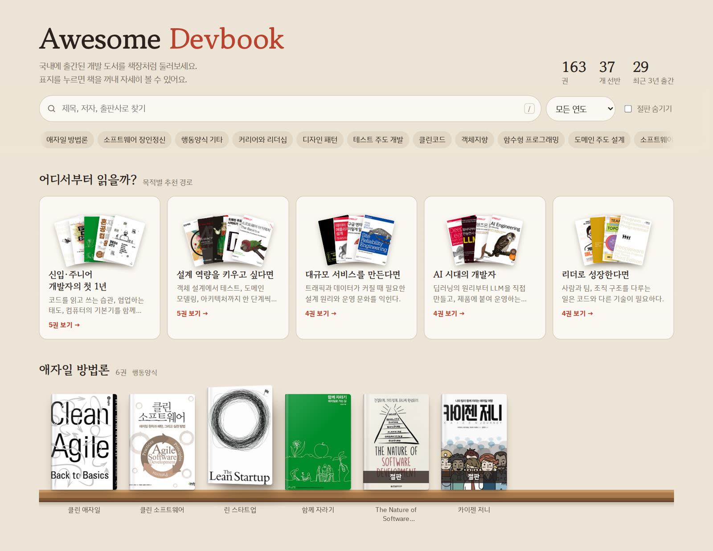

<!-- 이 파일은 scripts/build.mjs 가 data/*.yml 로부터 생성합니다. README.md 를 직접 고치지 말고 data/books.yml 을 고친 뒤 `npm run build` 를 실행하세요. -->
<h1 align="center">
	
	  Awesome Devbook
</h1>

	
	
	
	

<h3 align="center">
	<a href="https://738.github.io/awesome-devbook/">📚 웹 책장에서 표지로 둘러보기 →</a>
</h3>

	
	 
	분야별 선반 · 목적별 추천 경로 · 검색과 필터 · 표지를 누르면 상세 정보

## 개요

📖 국내에 출간된 개발 도서 리스트입니다. 모든 책은 ISBN으로 관리되고, 링크·절판 여부는 매주 자동으로 확인합니다.

📚 **163권** · 37개 분야 · 2023년 이후 출간 40권 · 절판 표기 20권

> 분류 설명 인용문은 <소프트웨어 장인>에서 발췌했습니다.

## 어디서부터 읽을까?

무엇부터 읽을지 막막하다면 목적에 맞는 경로부터 시작해 보세요.

<b>신입·주니어 개발자의 첫 1년</b> — 코드를 읽고 쓰는 습관, 협업하는 태도, 컴퓨터의 기본기를 함께 다진다.

1. [실용주의 프로그래머 20주년 기념판](https://www.aladin.co.kr/shop/wproduct.aspx?ISBN=9788966263363) - 데이비드 토머스, 앤드류 헌트
2. [읽기 좋은 코드가 좋은 코드다](https://www.aladin.co.kr/shop/wproduct.aspx?ISBN=9788979149142) - 더스틴 보즈웰, 트레버 파우커
3. [함께 자라기](https://www.aladin.co.kr/shop/wproduct.aspx?ISBN=9788966262335) - 김창준
4. [혼자 공부하는 컴퓨터 구조 + 운영체제](https://www.aladin.co.kr/shop/wproduct.aspx?ISBN=9791162243091) - 강민철
5. [개발자의 글쓰기](https://www.aladin.co.kr/shop/wproduct.aspx?ISBN=9791158391744) - 김철수

<b>설계 역량을 키우고 싶다면</b> — 객체 설계에서 테스트, 도메인 모델링, 아키텍처까지 한 단계씩 올라간다.

1. [오브젝트](https://www.aladin.co.kr/shop/wproduct.aspx?ISBN=9791158391409) - 조영호
2. [리팩터링 2판](https://www.aladin.co.kr/shop/wproduct.aspx?ISBN=9791162242742) - 마틴 파울러
3. [단위 테스트](https://www.aladin.co.kr/shop/wproduct.aspx?ISBN=9791161755748) - 블라디미르 코리코프
4. [도메인 주도 개발 시작하기](https://www.aladin.co.kr/shop/wproduct.aspx?ISBN=9791162245385) - 최범균
5. [소프트웨어 아키텍처 The Basics](https://www.aladin.co.kr/shop/wproduct.aspx?ISBN=9791199529854) - 마크 리처즈, 닐 포드

<b>대규모 서비스를 만든다면</b> — 트래픽과 데이터가 커질 때 필요한 설계 원리와 운영 문화를 익힌다.

1. [가상 면접 사례로 배우는 대규모 시스템 설계 기초](https://www.aladin.co.kr/shop/wproduct.aspx?ISBN=9788966263158) - 알렉스 쉬
2. [데이터 중심 애플리케이션 설계](https://www.aladin.co.kr/shop/wproduct.aspx?ISBN=9791158390983) - 마틴 클레프만 (절판)
3. [구글 엔지니어는 이렇게 일한다](https://www.aladin.co.kr/shop/wproduct.aspx?ISBN=9791162245620) - 타이터스 윈터스, 톰 맨쉬렉, 하이럼 라이트
4. [사이트 신뢰성 엔지니어링](https://www.aladin.co.kr/shop/wproduct.aspx?ISBN=9791188621088) - 벳시 베이어, 크리스 존스, 제니퍼 펫오프, 니얼 리처드 머피

<b>AI 시대의 개발자</b> — 딥러닝의 원리부터 LLM을 직접 만들고, 제품에 붙여 운영하는 법까지.

1. [밑바닥부터 시작하는 딥러닝 1](https://www.aladin.co.kr/shop/wproduct.aspx?ISBN=9791169213387) - 사이토 고키
2. [밑바닥부터 만들면서 배우는 LLM](https://www.aladin.co.kr/shop/wproduct.aspx?ISBN=9791140715848) - 세바스찬 라시카
3. [핸즈온 LLM](https://www.aladin.co.kr/shop/wproduct.aspx?ISBN=9791169213516) - 제이 알아마르, 마르턴 흐루턴도르스트
4. [AI 엔지니어링](https://www.aladin.co.kr/shop/wproduct.aspx?ISBN=9791169214278) - 칩 후옌

<b>리더로 성장한다면</b> — 사람과 팀, 조직 구조를 다루는 일은 코드와 다른 기술이 필요하다.

1. [개발 7년차, 매니저 1일차](https://www.aladin.co.kr/shop/wproduct.aspx?ISBN=9791162242551) - 카미유 푸르니에
2. [스태프 엔지니어](https://www.aladin.co.kr/shop/wproduct.aspx?ISBN=9791140701254) - 윌 라슨
3. [팀 토폴로지](https://www.aladin.co.kr/shop/wproduct.aspx?ISBN=9791161754802) - 매튜 스켈톤, 마누엘 페이스
4. [피플웨어](https://www.aladin.co.kr/shop/wproduct.aspx?ISBN=9788966261109) - 톰 드마르코, 티모시 리스터

## 목차

- [행동양식에 대한 서적](#행동양식에-대한-서적)
  - [애자일 방법론](#애자일-방법론) 6
  - [소프트웨어 장인정신](#소프트웨어-장인정신) 2
  - [행동양식 기타](#행동양식-기타) 14
  - [커리어와 리더십](#커리어와-리더십) 3
- [특정 개념에 대한 서적](#특정-개념에-대한-서적)
  - [디자인 패턴](#디자인-패턴) 2
  - [테스트 주도 개발](#테스트-주도-개발) 6
  - [클린코드](#클린코드) 4
  - [객체지향](#객체지향) 4
  - [함수형 프로그래밍](#함수형-프로그래밍) 4
  - [도메인 주도 설계](#도메인-주도-설계) 5
  - [소프트웨어 아키텍처](#소프트웨어-아키텍처) 7
- [특정 기술에 대한 서적](#특정-기술에-대한-서적)
  - [C](#c) 2
  - [C++](#c-1) 2
  - [Git](#git) 2
  - [자바](#자바) 4
  - [코틀린](#코틀린) 3
  - [자바스크립트](#자바스크립트) 6
  - [타입스크립트](#타입스크립트) 3
  - [파이썬](#파이썬) 6
  - [Go](#go) 2
  - [Rust](#rust) 2
  - [프론트엔드](#프론트엔드) 9
  - [백엔드](#백엔드) 8
  - [데이터베이스](#데이터베이스) 4
  - [데브옵스](#데브옵스) 8
  - [머신러닝](#머신러닝) 8
  - [AI와 LLM](#ai와-llm) 7
  - [안드로이드](#안드로이드) 3
  - [iOS](#ios) 3
- [컴퓨터과학](#컴퓨터과학)
  - [알고리즘](#알고리즘) 6
  - [컴퓨터구조](#컴퓨터구조) 3
  - [운영체제](#운영체제) 3
  - [네트워크](#네트워크) 4
  - [보안](#보안) 1
- [개발 관련 기타 서적](#개발-관련-기타-서적)
  - [인터뷰](#인터뷰) 5
  - [글쓰기](#글쓰기) 1
  - [영어](#영어) 1

## 행동양식에 대한 서적

> 효율적으로 팀에서 일할 수 있게 안내하거나, 일반적인 상황에서 더 나은 프로페셔널이 될 수 있도록 조언한다.

### 애자일 방법론

- [클린 애자일](https://www.aladin.co.kr/shop/wproduct.aspx?ISBN=9788966262861) - 로버트 C. 마틴 · 인사이트 · 2020
- [클린 소프트웨어 | 애자일 원칙과 패턴, 그리고 실천 방법](https://www.aladin.co.kr/shop/wproduct.aspx?ISBN=9791185890852) - 로버트 C. 마틴 · 제이펍 · 2017
- [린 스타트업 | 지속적 혁신을 실현하는 창업의 과학](https://www.aladin.co.kr/shop/wproduct.aspx?ISBN=9788966260577) - 에릭 리스 · 인사이트 · 2012
- [함께 자라기 | 애자일로 가는 길](https://www.aladin.co.kr/shop/wproduct.aspx?ISBN=9788966262335) - 김창준 · 인사이트 · 2018
- (**절판**) [The Nature of Software Development | 간결하게, 가치 있게, 하나씩 완성하기](https://www.aladin.co.kr/shop/wproduct.aspx?ISBN=9788968484650) - 론 제프리스 · 한빛미디어 · 2017
- (**절판**) [카이젠 저니](https://www.aladin.co.kr/shop/wproduct.aspx?ISBN=9791188621767) - 이치타니 토시히로, 아라이 타케시 · 제이펍 · 2019

### 소프트웨어 장인정신

- [소프트웨어 장인 | 프로페셔널리즘, 실용주의, 자부심](https://www.aladin.co.kr/shop/wproduct.aspx?ISBN=9791186659489) - 산드로 만쿠소 · 길벗 · 2015
- (**절판**) [소프트웨어 장인정신](https://www.aladin.co.kr/shop/wproduct.aspx?ISBN=9788945071415) - Pete McBreen · 피어슨에듀케이션코리아 · 2002

### 행동양식 기타

- [실용주의 프로그래머 20주년 기념판](https://www.aladin.co.kr/shop/wproduct.aspx?ISBN=9788966263363) - 데이비드 토머스, 앤드류 헌트 · 인사이트 · 2022
- [익스트림 프로그래밍](https://www.aladin.co.kr/shop/wproduct.aspx?ISBN=9788991268104) - 켄트 벡, 신시아 안드레스 · 인사이트 · 2006
- [해커와 화가](https://www.aladin.co.kr/shop/wproduct.aspx?ISBN=9788968480713) - 폴 그레이엄 · 한빛미디어 · 2014
- [CODE 코드 | 하드웨어와 소프트웨어에 숨어 있는 언어](https://www.aladin.co.kr/shop/wproduct.aspx?ISBN=9788966264285) - 찰스 펫졸드 · 인사이트 · 2023
- [피플웨어](https://www.aladin.co.kr/shop/wproduct.aspx?ISBN=9788966261109) - 톰 드마르코, 티모시 리스터 · 인사이트 · 2014
- [생각하는 프로그래밍 | 프로그래밍 본질에 관한 15가지 에세이](https://www.aladin.co.kr/shop/wproduct.aspx?ISBN=9788966260997) - 존 벤틀리 · 인사이트 · 2013
- [조엘 온 소프트웨어 | 유쾌한 오프라인 블로그](https://www.aladin.co.kr/shop/wproduct.aspx?ISBN=9788989975588) - 조엘 스폴스키 · 에이콘출판 · 2005
- [맨먼스 미신 | 소프트웨어 공학에 관한 에세이](https://www.aladin.co.kr/shop/wproduct.aspx?ISBN=9788966261321) - 프레더릭 브룩스 · 인사이트 · 2015
- [더 나은 프로그래머 되는 법 | 지금 바로 실천할 수 있는 선배 개발자의 39가지 노하우 / 국내 개발자 8인 인터뷰 수록](https://www.aladin.co.kr/shop/wproduct.aspx?ISBN=9791169212335) - 피트 구들리프 · 한빛미디어 · 2024
- [구글 엔지니어는 이렇게 일한다 | 구글러가 전하는 문화, 프로세스, 도구의 모든 것](https://www.aladin.co.kr/shop/wproduct.aspx?ISBN=9791162245620) - 타이터스 윈터스, 톰 맨쉬렉, 하이럼 라이트 · 한빛미디어 · 2022
- [프로그래머의 뇌 | 훌륭한 프로그래머가 알아야 할 인지과학의 모든 것](https://www.aladin.co.kr/shop/wproduct.aspx?ISBN=9791191600650) - 펠리너 헤르만스 · 제이펍 · 2022
- [좋은 코드, 나쁜 코드 | 프로그래머의 코드 품질 개선법](https://www.aladin.co.kr/shop/wproduct.aspx?ISBN=9791191600896) - 톰 롱 · 제이펍 · 2022
- [읽기 좋은 코드가 좋은 코드다 | 더 나은 코드를 작성하는 간단하고 실전적인 테크닉](https://www.aladin.co.kr/shop/wproduct.aspx?ISBN=9788979149142) - 더스틴 보즈웰, 트레버 파우커 · 한빛미디어 · 2012
- [팀 토폴로지 | 빠른 업무 플로우를 만드는 조직 설계](https://www.aladin.co.kr/shop/wproduct.aspx?ISBN=9791161754802) - 매튜 스켈톤, 마누엘 페이스 · 에이콘출판 · 2020

### 커리어와 리더십

- [개발 7년차, 매니저 1일차 | 개발만 해왔던 내가, 어느 날 갑자기 '팀'을 맡았다!](https://www.aladin.co.kr/shop/wproduct.aspx?ISBN=9791162242551) - 카미유 푸르니에 · 한빛미디어 · 2020
- [스태프 엔지니어 | 관리 트랙을 넘어선 기술 리더십](https://www.aladin.co.kr/shop/wproduct.aspx?ISBN=9791140701254) - 윌 라슨 · 길벗 · 2022
- [프로그래머의 길, 멘토에게 묻다](https://www.aladin.co.kr/shop/wproduct.aspx?ISBN=9788991268807) - 데이브 후버, 애디웨일 오시나이 · 인사이트 · 2010

**[⬆ 맨 위로 이동](#목차)**

## 특정 개념에 대한 서적

> 커리어를 진전시킬 때 필요한 기초를 쌓을 수 있는 책이다. 새로운 개념이나 패러다임 또는 실행 관례들을 소개한다. 당장 활용하기는 어렵고, 제대로 이해하고 습득하는 데 긴 시간이 필요할 때도 있다.

### 디자인 패턴

- [GoF의 디자인 패턴 | 재사용성을 지닌 객체지향 소프트웨어의 핵심요소](https://www.aladin.co.kr/shop/wproduct.aspx?ISBN=9791195444953) - 에릭 감마, 리처드 헬름, 랄프 존슨, 존 블리시디스 · 프로텍미디어 · 2015
- [헤드 퍼스트 디자인 패턴 개정판](https://www.aladin.co.kr/shop/wproduct.aspx?ISBN=9791162245262) - 에릭 프리먼 · 한빛미디어 · 2022

### 테스트 주도 개발

- [테스트 주도 개발](https://www.aladin.co.kr/shop/wproduct.aspx?ISBN=9788966261024) - 켄트 벡 · 인사이트 · 2014
- [테스트 주도 개발로 배우는 객체 지향 설계와 실천](https://www.aladin.co.kr/shop/wproduct.aspx?ISBN=9788966260836) - 스티브 프리먼, 냇 프라이스 · 인사이트 · 2013
- (**절판**) [클린 코드를 위한 테스트 주도 개발 | 파이썬을 이용한](https://www.aladin.co.kr/shop/wproduct.aspx?ISBN=9788994774916) - 해리 J. W. 퍼시벌 · 비제이퍼블릭 · 2015
- (**절판**) [테스트 주도 개발 | 고품질 쾌속개발을 위한 TDD 실천법과 도구](https://www.aladin.co.kr/shop/wproduct.aspx?ISBN=9788979147261) - 채수원 · 한빛미디어 · 2010
- [단위 테스트 | 생산성과 품질을 위한 단위 테스트 원칙과 패턴](https://www.aladin.co.kr/shop/wproduct.aspx?ISBN=9791161755748) - 블라디미르 코리코프 · 에이콘출판 · 2021
- [테스트 주도 개발 시작하기](https://www.aladin.co.kr/shop/wproduct.aspx?ISBN=9788980783052) - 최범균 · 가메출판사 · 2020

### 클린코드

- [리팩터링 2판 | 코드 구조를 체계적으로 개선하여 효율적인 리팩터링 구현하기](https://www.aladin.co.kr/shop/wproduct.aspx?ISBN=9791162242742) - 마틴 파울러 · 한빛미디어 · 2020
- [클린 코드 2판 | 애자일 소프트웨어 장인 정신](https://www.aladin.co.kr/shop/wproduct.aspx?ISBN=9788966265527) - 로버트 C. 마틴 · 인사이트 · 2026
- [클린코더 | 단순 기술자에서 진정한 소프트웨어 장인이 되기까지](https://www.aladin.co.kr/shop/wproduct.aspx?ISBN=9788960778818) - 로버트 C. 마틴 · 에이콘출판 · 2016
- [클린 아키텍처 | 소프트웨어 구조와 설계의 원칙](https://www.aladin.co.kr/shop/wproduct.aspx?ISBN=9788966262472) - 로버트 C. 마틴 · 인사이트 · 2019

### 객체지향

- [오브젝트 | 코드로 이해하는 객체지향 설계](https://www.aladin.co.kr/shop/wproduct.aspx?ISBN=9791158391409) - 조영호 · 위키북스 · 2019
- [객체지향의 사실과 오해 | 역할, 책임, 협력 관점에서 본 객체지향](https://www.aladin.co.kr/shop/wproduct.aspx?ISBN=9788998139766) - 조영호 · 위키북스 · 2015
- [엘레강트 오브젝트 | 새로운 관점에서 바라본 객체지향](https://www.aladin.co.kr/shop/wproduct.aspx?ISBN=9791187497219) - 예고르 부가옌코 · 지&선(지앤선) · 2021
- [루비로 배우는 객체지향 디자인 | 지속가능한 소프트웨어를 만드는 방법](https://www.aladin.co.kr/shop/wproduct.aspx?ISBN=9788966261239) - 샌디 메츠 · 인사이트 · 2014

### 함수형 프로그래밍

- (**절판**) [스칼라로 배우는 함수형 프로그래밍](https://www.aladin.co.kr/shop/wproduct.aspx?ISBN=9791185890180) - 폴 키우사노, 루나르 비아르드나손 · 제이펍 · 2015
- [함수형 자바스크립트 프로그래밍](https://www.aladin.co.kr/shop/wproduct.aspx?ISBN=9788966262120) - 유인동 · 인사이트 · 2017
- (**절판**) [함수형 사고 | 객체지향 개발자에서 함수형 개발자로 거듭나기](https://www.aladin.co.kr/shop/wproduct.aspx?ISBN=9788968482960) - 닐 포드 · 한빛미디어 · 2016
- [쏙쏙 들어오는 함수형 코딩 | 심플한 코드로 복잡한 소프트웨어 길들이기](https://www.aladin.co.kr/shop/wproduct.aspx?ISBN=9791191600759) - 에릭 노먼드 · 제이펍 · 2022

### 도메인 주도 설계

- [도메인 주도 설계 | 소프트웨어의 복잡성을 다루는 지혜](https://www.aladin.co.kr/shop/wproduct.aspx?ISBN=9788992939850) - 에릭 에반스 · 위키북스 · 2011
- [도메인 주도 설계 핵심 | 핵심을 간추린 비즈니스 중심의 설계로 소프트웨어 개발 프로젝트 성공하기](https://www.aladin.co.kr/shop/wproduct.aspx?ISBN=9791161750576) - 반 버논 · 에이콘출판 · 2017
- [도메인 주도 개발 시작하기 | DDD 핵심 개념 정리부터 구현까지](https://www.aladin.co.kr/shop/wproduct.aspx?ISBN=9791162245385) - 최범균 · 한빛미디어 · 2022
- [도메인 주도 설계 첫걸음 | 소프트웨어 아키텍처와 비즈니스 전략의 일치를 위한 핵심 패턴, 원칙, 실천법](https://www.aladin.co.kr/shop/wproduct.aspx?ISBN=9791158393359) - 블라드 코노노프 · 위키북스 · 2022
- [도메인 주도 설계 구현](https://www.aladin.co.kr/shop/wproduct.aspx?ISBN=9788960778429) - 반 버논 · 에이콘출판 · 2016

### 소프트웨어 아키텍처

- [소프트웨어 아키텍처 The Basics | 모던 엔지니어링을 위한 소프트웨어 아키텍처의 모든 것](https://www.aladin.co.kr/shop/wproduct.aspx?ISBN=9791199529854) - 마크 리처즈, 닐 포드 · 한빛미디어 · 2025
- [소프트웨어 아키텍처 The Hard Parts | 분산 아키텍처를 위한 모던 트레이드오프 분석](https://www.aladin.co.kr/shop/wproduct.aspx?ISBN=9791169210294) - 닐 포드, 마크 리처즈, 세막 데그하니 · 한빛미디어 · 2022
- (**절판**) [데이터 중심 애플리케이션 설계 | 신뢰할 수 있고 확장 가능하며 유지보수하기 쉬운 시스템을 지탱하는 핵심 아이디어](https://www.aladin.co.kr/shop/wproduct.aspx?ISBN=9791158390983) - 마틴 클레프만 · 위키북스 · 2018
- [마이크로서비스 패턴 | 자바 예제로 배우는 서비스 분해, 트랜잭션 관리, CQRS, 테스트 핵심 패턴](https://www.aladin.co.kr/shop/wproduct.aspx?ISBN=9791165210441) - 크리스 리처드슨 · 길벗 · 2020
- (**절판**) [만들면서 배우는 클린 아키텍처 | 자바 코드로 구현하는 클린 웹 애플리케이션](https://www.aladin.co.kr/shop/wproduct.aspx?ISBN=9791158392758) - 톰 홈버그 · 위키북스 · 2021
- [가상 면접 사례로 배우는 대규모 시스템 설계 기초](https://www.aladin.co.kr/shop/wproduct.aspx?ISBN=9788966263158) - 알렉스 쉬 · 인사이트 · 2021
- [가상 면접 사례로 배우는 대규모 시스템 설계 기초 2](https://www.aladin.co.kr/shop/wproduct.aspx?ISBN=9788966264254) - 알렉스 쉬, 산 람 · 인사이트 · 2024

**[⬆ 맨 위로 이동](#목차)**

## 특정 기술에 대한 서적

> 업무를 위해 어떤 프레임워크나 프로그래밍 언어 또는 특정 소프트웨어의 이용 방법을 급하게 알아야 할 때 꼭 필요하다. 당장의 업무에는 유용하지만 그 가치가 오래가지는 않는다. 기술 서적은 당면한 업무와 관련된 것들에 대해 상세하고 심도 있는 기술 지식을 제공한다. 커리어의 다음 단계를 계획하는 데도 큰 도움이 된다.

### C

- (**절판**) [윤성우의 열혈 C 프로그래밍](https://www.aladin.co.kr/shop/wproduct.aspx?ISBN=9788996094050) - 윤성우 · 오렌지미디어 · 2010
- (**절판**) [독하게 시작하는 C 프로그래밍 | 널널한 개발자의 C 언어 마스터클래스](https://www.aladin.co.kr/shop/wproduct.aspx?ISBN=9791195149209) - 최호성 · 루비페이퍼 · 2015

### C++

- [윤성우의 열혈 C++ 프로그래밍](https://www.aladin.co.kr/shop/wproduct.aspx?ISBN=9788996094043) - 윤성우 · 오렌지미디어 · 2010
- [이펙티브 모던 C++ | C++11과 C++14를 효과적으로 사용하는 42가지 방법](https://www.aladin.co.kr/shop/wproduct.aspx?ISBN=9788966261642) - 스콧 마이어스 · 인사이트 · 2015

### Git

- [프로 Git 2판 | 그림으로 이해하는 Git의 작동 원리와 사용법](https://www.aladin.co.kr/shop/wproduct.aspx?ISBN=9788966261789) - 스캇 샤콘, 벤 스트라웁 · 인사이트 · 2016
- [팀 개발을 위한 Git, GitHub 시작하기 | 소스 코드 버전 관리를 위한 깃·깃허브, 오픈 소스 참여](https://www.aladin.co.kr/shop/wproduct.aspx?ISBN=9791169210607) - 정호영, 진유림 · 한빛미디어 · 2023

### 자바

- [이펙티브 자바](https://www.aladin.co.kr/shop/wproduct.aspx?ISBN=9788966262281) - 조슈아 블로크 · 인사이트 · 2018
- [모던 자바 인 액션 | 람다, 스트림, 함수형, 리액티브 프로그래밍으로 새로워진 자바 마스터하기](https://www.aladin.co.kr/shop/wproduct.aspx?ISBN=9791162242025) - 라울-게이브리얼 우르마, 마리오 푸스코, 앨런 마이크로프트 · 한빛미디어 · 2019
- [자바 ORM 표준 JPA 프로그래밍 | 스프링 데이터 예제 프로젝트로 배우는 전자정부 표준 데이터베이스 프레임워크](https://www.aladin.co.kr/shop/wproduct.aspx?ISBN=9788960777330) - 김영한 · 에이콘출판 · 2015
- [Java의 정석 4판](https://www.aladin.co.kr/shop/wproduct.aspx?ISBN=9788994492001) - 남궁성 · 도우출판 · 2025

### 코틀린

- [코틀린 인 액션 2/e | 코틀린 컴파일러 개발자가 직접 알려주는 코틀린 언어 핵심 (코루틴과 플로우 포함 코틀린 2 대응)](https://www.aladin.co.kr/shop/wproduct.aspx?ISBN=9791161759692) - 드미트리 제메로프, 스베트라나 이사코바 · 에이콘출판 · 2025
- [코틀린 아카데미 : 이펙티브 코틀린](https://www.aladin.co.kr/shop/wproduct.aspx?ISBN=9788966264612) - 마르친 모스카와 · 인사이트 · 2025
- [코틀린 코루틴의 정석 | 기초부터 심화까지 알아보는](https://www.aladin.co.kr/shop/wproduct.aspx?ISBN=9791161758251) - 조세영 · 에이콘출판 · 2024

### 자바스크립트

- [자바스크립트 완벽 가이드](https://www.aladin.co.kr/shop/wproduct.aspx?ISBN=9788966263462) - 데이비드 플래너건 · 인사이트 · 2022
- [You Don’t Know JS Yet | 자바스크립트 개념, 스코프와 클로저](https://www.aladin.co.kr/shop/wproduct.aspx?ISBN=9791169211888) - 카일 심슨 · 한빛미디어 · 2024
- [코어 자바스크립트 | 핵심 개념과 동작 원리로 이해하는 자바스크립트 프로그래밍](https://www.aladin.co.kr/shop/wproduct.aspx?ISBN=9791158391720) - 정재남 · 위키북스 · 2019
- (**절판**) [인사이드 자바스크립트 | 핵심 개념과 원리를 정확하게 jQuery Node.js 클로저의 개념까지, Inside JavaScript](https://www.aladin.co.kr/shop/wproduct.aspx?ISBN=9788968480652) - 송형주, 고현준 · 한빛미디어 · 2014
- [자바스크립트 코딩의 기술 | 똑똑하게 코딩하는 법](https://www.aladin.co.kr/shop/wproduct.aspx?ISBN=9791165210205) - 조 모건 · 길벗 · 2019
- [모던 자바스크립트 Deep Dive | 자바스크립트의 기본 개념과 동작 원리](https://www.aladin.co.kr/shop/wproduct.aspx?ISBN=9791158392239) - 이웅모 · 위키북스 · 2020

### 타입스크립트

- [이펙티브 타입스크립트 | 동작 원리의 이해와 구체적인 조언 83가지](https://www.aladin.co.kr/shop/wproduct.aspx?ISBN=9788966265046) - 댄 밴더캄 · 인사이트 · 2025
- [러닝 타입스크립트 | 안정적인 웹 프로젝트 운영을 위한 타입스크립트의 모든 것](https://www.aladin.co.kr/shop/wproduct.aspx?ISBN=9791169210638) - 조시 골드버그 · 한빛미디어 · 2023
- [우아한 타입스크립트 with 리액트 | 배달의민족 개발 사례로 살펴보는 우아한형제들의 타입스크립트와 리액트 활용법](https://www.aladin.co.kr/shop/wproduct.aspx?ISBN=9791169211567) - 우아한형제들 웹프론트개발그룹, 권기석, 권세진, 고우혁, 김정혁, 박선희, 서그림, 송지은, 송하영, 심문성, 이정민, 이수연, 이예지, 이강열, 조은현, 최현준, 황윤서 · 한빛미디어 · 2023

### 파이썬

- [파이썬 클린 코드 | 유지보수가 쉬운 파이썬 코드를 만드는 비결](https://www.aladin.co.kr/shop/wproduct.aspx?ISBN=9791161341330) - 마리아노 아나야 · 터닝포인트 · 2022
- [슬기로운 파이썬 트릭 | 짧고 흥미로운 코드로 배우는 파이썬 실용 코딩](https://www.aladin.co.kr/shop/wproduct.aspx?ISBN=9788966262342) - 댄 베이더 · 인사이트 · 2019
- (**절판**) [이펙티브 파이썬 2판 | 똑똑하게 코딩하는 법](https://www.aladin.co.kr/shop/wproduct.aspx?ISBN=9791165213190) - 브렛 슬라킨 · 길벗 · 2020
- [Do it! 점프 투 파이썬](https://www.aladin.co.kr/shop/wproduct.aspx?ISBN=9791163034735) - 박응용 · 이지스퍼블리싱 · 2023
- [전문가를 위한 파이썬 | 간단하고, 명료하고, 효율적인 파이썬 프로그래밍](https://www.aladin.co.kr/shop/wproduct.aspx?ISBN=9791169211772) - 루시아누 하말류 · 한빛미디어 · 2024
- [혼자 공부하는 파이썬 | 1:1 과외하듯 배우는 프로그래밍 자습서](https://www.aladin.co.kr/shop/wproduct.aspx?ISBN=9791162245651) - 윤인성 · 한빛미디어 · 2022

### Go

- [Tucker의 Go 언어 프로그래밍 | Golang 입문부터 HTTPS, RESTful API, Gin, gnet, gRPC을 활용하는 서버 네트워크 기법까지](https://www.aladin.co.kr/shop/wproduct.aspx?ISBN=9791191905809) - 공봉식 · 골든래빗(주) · 2024
- [러닝 Go | Go 개발자처럼 생각하는 방법](https://www.aladin.co.kr/shop/wproduct.aspx?ISBN=9791162245309) - 존 보드너 · 한빛미디어 · 2022

### Rust

- [러스트 프로그래밍 공식 가이드 | 러스타시안 커뮤니티가 직접 만든 RUST 2021 공식 가이드북](https://www.aladin.co.kr/shop/wproduct.aspx?ISBN=9791192987422) - 스티브 클라브닉, 캐럴 니컬스 · 제이펍 · 2024
- [프로그래밍 러스트 | 빠르고 안전한 시스템 개발](https://www.aladin.co.kr/shop/wproduct.aspx?ISBN=9791192469751) - 짐 블랜디, 제이슨 오렌도프, 리어노라 틴달 · 제이펍 · 2023

### 프론트엔드

#### 리액트

- [리액트를 다루는 기술 | 입문부터 대규모 애플리케이션까지 한 권으로](https://www.aladin.co.kr/shop/wproduct.aspx?ISBN=9791160508796) - 김민준 · 길벗 · 2019
- [실전 리액트 프로그래밍 개정판 | 리액트 훅부터 Next.js까지](https://www.aladin.co.kr/shop/wproduct.aspx?ISBN=9788966262670) - 이재승 · 인사이트 · 2020
- (**절판**) [Do it! 리액트 프로그래밍 정석 | 실리콘밸리 개발 방법으로 배우는](https://www.aladin.co.kr/shop/wproduct.aspx?ISBN=9791163031451) - 박호준 · 이지스퍼블리싱 · 2020
- [모던 리액트 Deep Dive | 리액트의 핵심 개념과 동작 원리부터 Next.js까지, 리액트의 모든 것](https://www.aladin.co.kr/shop/wproduct.aspx?ISBN=9791158394646) - 김용찬 · 위키북스 · 2023
- [리액트 훅을 활용한 마이크로 상태 관리 | 리액트 상태 관리의 기본 개념부터 동작 원리와 문제 해결, 렌더링 최적화 기법까지](https://www.aladin.co.kr/shop/wproduct.aspx?ISBN=9791158394899) - 다이시 카토 · 위키북스 · 2024

#### 뷰

- [Do it! Vue.js 입문](https://www.aladin.co.kr/shop/wproduct.aspx?ISBN=9791188612789) - 장기효 · 이지스퍼블리싱 · 2018
- [커피 한 잔 마시며 끝내는 Vue.JS | Vue.JS를 통해 실전 애플리케이션 구축하기](https://www.aladin.co.kr/shop/wproduct.aspx?ISBN=9791190014397) - 김영훈, 문동욱 · 비제이퍼블릭 · 2019

#### 앵귤러

- [Angular Essentials | ES6, TypeScript 핵심 완벽 설명](https://www.aladin.co.kr/shop/wproduct.aspx?ISBN=9791186710340) - 이웅모 · 루비페이퍼 · 2018

#### 웹 성능

- [프론트엔드 성능 최적화 가이드 | 웹 개발 스킬을 한 단계 높여 주는](https://www.aladin.co.kr/shop/wproduct.aspx?ISBN=9788966263745) - 유동균 · 인사이트 · 2022

### 백엔드

#### 스프링

- [토비의 스프링](https://www.aladin.co.kr/shop/wproduct.aspx?ISBN=9788960773431) - 이일민 · 에이콘출판 · 2012
- [스프링 입문을 위한 자바 객체 지향의 원리와 이해](https://www.aladin.co.kr/shop/wproduct.aspx?ISBN=9788998139940) - 김종민 · 위키북스 · 2015
- [스프링 부트와 AWS로 혼자 구현하는 웹 서비스 | 인텔리제이, JPA, JUnit 테스트, 그레이들, 소셜 로그인, AWS 인프라로 무중단 배포까지](https://www.aladin.co.kr/shop/wproduct.aspx?ISBN=9788965402602) - 이동욱 · 프리렉 · 2019
- [코드로 배우는 스프링 웹 프로젝트 | 현업 개발을 위한 단계별 실습서](https://www.aladin.co.kr/shop/wproduct.aspx?ISBN=9791189184018) - 구멍가게 코딩단 · 남가람북스 · 2018
- [스프링 6 레시피 | 스프링 애플리케이션 개발에 유용한 137가지 문제 해결 기법](https://www.aladin.co.kr/shop/wproduct.aspx?ISBN=9791169214254) - 마틴 데니엄, 다니엘 루비오, 조시 롱 · 한빛미디어 · 2025
- [스프링 인 액션 5판 | 스프링 5의 강력한 기능과 생산성을 활용한 웹 애플리케이션 개발](https://www.aladin.co.kr/shop/wproduct.aspx?ISBN=9791190665186) - 크레이그 월즈 · 제이펍 · 2020

#### Node.js

- [Node.js + NestJS 교과서 | 안정적인 AI 서비스를 만들기 위한 Node.js + NestJS 입문서](https://www.aladin.co.kr/shop/wproduct.aspx?ISBN=9791140718924) - 조현영 · 길벗 · 2026

#### HTTP

- [HTTP 완벽 가이드 | 웹은 어떻게 동작하는가](https://www.aladin.co.kr/shop/wproduct.aspx?ISBN=9788966261208) - 데이빗 고울리, 브라이언 토티, 마조리 세이어, 세일루 레디, 안슈 아가왈 · 인사이트 · 2014

### 데이터베이스

- [Real MySQL 8.0 | 개발자와 DBA를 위한 MySQL 실전 가이드](https://www.aladin.co.kr/shop/wproduct.aspx?ISBN=9791158392703) - 백은빈, 이성욱 · 위키북스 · 2021
- [친절한 SQL 튜닝 | 개발자를 위한 SQL 튜닝 입문서 / SQLP 핵심이론 집중 공략](https://www.aladin.co.kr/shop/wproduct.aspx?ISBN=9791196395704) - 조시형 · DBian(디비안) · 2018
- [데이터베이스 인터널스 | 분산 데이터베이스 시스템 심층 분석](https://www.aladin.co.kr/shop/wproduct.aspx?ISBN=9791161754963) - 알렉스 페트로프 · 에이콘출판 · 2021
- [SQL 레벨업 | DB 성능 최적화를 위한 SQL 실전 가이드](https://www.aladin.co.kr/shop/wproduct.aspx?ISBN=9788968482519) - 미크 · 한빛미디어 · 2016

### 데브옵스

- [Kubernetes in Action | 그림과 상세한 설명을 통한 쿠버네티스 완벽 이해](https://www.aladin.co.kr/shop/wproduct.aspx?ISBN=9791161754048) - 마르코 룩샤 · 에이콘출판 · 2020
- [데브옵스 핸드북 2/e | 세계 최고 수준의 기민성, 신뢰성, 안정성을 갖춘 기술 조직의 비밀](https://www.aladin.co.kr/shop/wproduct.aspx?ISBN=9791161758480) - 진 킴, 제즈 험블, 패트릭 드부아, 존 윌리스, 니콜 포스그렌 · 에이콘출판 · 2024
- (**절판**) [Kafka Streams in Action | 카프카 스트림즈 API로 만드는 실시간 애플리케이션](https://www.aladin.co.kr/shop/wproduct.aspx?ISBN=9791161753263) - 윌리엄 베젝 · 에이콘출판 · 2019
- (**절판**) [애플리케이션 프로그래밍 with 자바(아파치 카프카) | 카프카의 개념부터 스트림즈, 커넥트, 스프링 카프카까지](https://www.aladin.co.kr/shop/wproduct.aspx?ISBN=9791165920548) - 최원영 · 비제이퍼블릭 · 2021
- [그림과 실습으로 배우는 도커 & 쿠버네티스 | 개념과 작동 원리가 쏙쏙 이해되는 완벽 입문서](https://www.aladin.co.kr/shop/wproduct.aspx?ISBN=9791158393038) - 오가사와라 시게타카 · 위키북스 · 2022
- [사이트 신뢰성 엔지니어링 | 구글이 공개하는 서비스 개발과 운영 노하우](https://www.aladin.co.kr/shop/wproduct.aspx?ISBN=9791188621088) - 벳시 베이어, 크리스 존스, 제니퍼 펫오프, 니얼 리처드 머피 · 제이펍 · 2018
- [테라폼 업앤러닝 2판](https://www.aladin.co.kr/shop/wproduct.aspx?ISBN=9791186710661) - 예브게니 브릭만 · 루비페이퍼 · 2021
- [AWS 교과서 | AWS 입문의 정석, 개념 설명과 실습 예제로 실속 있게 구성한 AWS 입문서!](https://www.aladin.co.kr/shop/wproduct.aspx?ISBN=9791140719310) - 김원일, 서종호, 김석필 · 길벗 · 2026

### 머신러닝

- [밑바닥부터 시작하는 딥러닝 1 | 파이썬으로 익히는 딥러닝 이론과 구현](https://www.aladin.co.kr/shop/wproduct.aspx?ISBN=9791169213387) - 사이토 고키 · 한빛미디어 · 2025
- [파이썬 라이브러리를 활용한 머신러닝 | 번역개정판, 사이킷런 핵심 개발자가 쓴 머신러닝과 데이터 과학 실무서](https://www.aladin.co.kr/shop/wproduct.aspx?ISBN=9791162245279) - 안드레아스 뮐러, 세라 가이도 · 한빛미디어 · 2022
- [단단한 머신러닝 | 머신러닝 기본 개념을 제대로 정리한 인공지능 교과서](https://www.aladin.co.kr/shop/wproduct.aspx?ISBN=9791188621989) - 조우쯔화 · 제이펍 · 2020
- (**절판**) [머신러닝 탐구생활 | Kaggle 우승작으로 배우는, 파이썬을 활용한 머신러닝 실전 예제 분석](https://www.aladin.co.kr/shop/wproduct.aspx?ISBN=9791186697696) - 정권우 · 비제이퍼블릭 · 2018
- (**절판**) [파이썬으로 배우는 딥러닝 교과서 | 이미지 인식 모델을 만들면서 익히는 딥러닝](https://www.aladin.co.kr/shop/wproduct.aspx?ISBN=9791162242827) - 이시카와 아키히코 · 한빛미디어 · 2020
- [핸즈온 머신러닝 3판 | 사이킷런, 케라스, 텐서플로 2로 완벽 이해하는 머신러닝, 딥러닝 이론 & 실무](https://www.aladin.co.kr/shop/wproduct.aspx?ISBN=9791169211475) - 오렐리앙 제롱 · 한빛미디어 · 2023
- [혼자 공부하는 머신러닝 + 딥러닝 | 케라스와 파이토치로 1:1 과외하듯 배우는 인공지능 자습서, 별책 용어노트, 저자 직강 유튜브 강의 제공](https://www.aladin.co.kr/shop/wproduct.aspx?ISBN=9791169213608) - 박해선 · 한빛미디어 · 2025
- [머신러닝 시스템 설계 | 프로젝트 범위 산정부터 프로덕션 배포 후 모니터링까지, MLOps 완벽 해부하기](https://www.aladin.co.kr/shop/wproduct.aspx?ISBN=9791169210850) - 칩 후옌 · 한빛미디어 · 2023

### AI와 LLM

- [밑바닥부터 만들면서 배우는 LLM | GPT를 내 손으로 직접 단계별로 만들어보면서 대규모 언어 모델의 기본기를 탄탄히 채우기](https://www.aladin.co.kr/shop/wproduct.aspx?ISBN=9791140715848) - 세바스찬 라시카 · 길벗 · 2025
- [핸즈온 LLM | 프롬프트 엔지니어링부터 임베딩, 시맨틱 검색, 미세 튜닝까지, 손에 잡히는 LLM 개념](https://www.aladin.co.kr/shop/wproduct.aspx?ISBN=9791169213516) - 제이 알아마르, 마르턴 흐루턴도르스트 · 한빛미디어 · 2025
- [AI 엔지니어링 | 파운데이션 모델을 활용한 시스템 설계부터 개선까지, AI 앱 개발 원스톱 가이드](https://www.aladin.co.kr/shop/wproduct.aspx?ISBN=9791169214278) - 칩 후옌 · 한빛미디어 · 2025
- [LLM을 활용한 실전 AI 애플리케이션 개발 | LLM의 기본부터 모델 학습, 임베딩, 벡터 데이터베이스로 만드는 RAG까지](https://www.aladin.co.kr/shop/wproduct.aspx?ISBN=9791189909703) - 허정준 · 책만 · 2024
- [만들면서 배우는 생성 AI | 트랜스포머부터 GPT, DALL·E 2, 스테이블 디퓨전, 플라밍고까지](https://www.aladin.co.kr/shop/wproduct.aspx?ISBN=9791169211437) - 데이비드 포스터 · 한빛미디어 · 2023
- [밑바닥부터 시작하는 딥러닝 5 | 10단계로 익히는 이미지 생성 모델의 원리](https://www.aladin.co.kr/shop/wproduct.aspx?ISBN=9791169212960) - 사이토 고키 · 한빛미디어 · 2024
- [가상 면접 사례로 배우는 생성형 AI 서비스 설계](https://www.aladin.co.kr/shop/wproduct.aspx?ISBN=9788966265213) - 알리 아미니안, 하오 성 · 인사이트 · 2026

### 안드로이드

- [깡샘의 안드로이드 프로그래밍 | 95개 실습 예제와 해설 동영상 강의 수록](https://www.aladin.co.kr/shop/wproduct.aspx?ISBN=9791186710210) - 강성윤 · 루비페이퍼 · 2019
- (**절판**) [Do it! 안드로이드 앱 프로그래밍](https://www.aladin.co.kr/shop/wproduct.aspx?ISBN=9791163032625) - 정재곤 · 이지스퍼블리싱 · 2021
- [이것이 안드로이드다 with 코틀린 | 안드로이드 입문의 3가지 장벽, 언어+실전+환경 완벽 대응!](https://www.aladin.co.kr/shop/wproduct.aspx?ISBN=9791162245026) - 고돈호 · 한빛미디어 · 2022

### iOS

- [꼼꼼한 재은 씨의 스위프트 시리즈](https://www.aladin.co.kr/shop/wproduct.aspx?ISBN=9791186710234) - 이재은 · 루비페이퍼 · 2017
- [스위프트 프로그래밍 | 모던 스위프트 개발의 핵심! 패러다임과 매크로 그리고 동시성까지](https://www.aladin.co.kr/shop/wproduct.aspx?ISBN=9791169213905) - 야곰 · 한빛미디어 · 2025
- [Do it! 스위프트로 아이폰 앱 만들기 입문](https://www.aladin.co.kr/shop/wproduct.aspx?ISBN=9791163036807) - 송호정, 이범근 · 이지스퍼블리싱 · 2025

**[⬆ 맨 위로 이동](#목차)**

## 컴퓨터과학

### 알고리즘

- [윤성우의 열혈 자료구조 | C언어를 이용한 자료구조 학습서](https://www.aladin.co.kr/shop/wproduct.aspx?ISBN=9788996094067) - 윤성우 · 오렌지미디어 · 2012
- [알고리즘 문제 해결 전략 | 프로그래밍 대회에서 배우는](https://www.aladin.co.kr/shop/wproduct.aspx?ISBN=9788966260546) - 구종만 · 인사이트 · 2012
- [알고리즘 트레이닝 | 프로그래밍 대회 입문 가이드](https://www.aladin.co.kr/shop/wproduct.aspx?ISBN=9788966263479) - 안티 라크소넨 · 인사이트 · 2022
- [다이내믹 프로그래밍 완전정복 | 빠르고 우아한 상향식 문제 풀이법](https://www.aladin.co.kr/shop/wproduct.aspx?ISBN=9791162242063) - 미나크시, 카말 라와트 · 한빛미디어 · 2019
- (**절판**) [Hello Coding 그림으로 개념을 이해하는 알고리즘](https://www.aladin.co.kr/shop/wproduct.aspx?ISBN=9788968483547) - 아디트야 바르가바 · 한빛미디어 · 2017
- [누워서 읽는 알고리즘 | 프로그래밍 상상력을 키워주는 알고리즘 이야기](https://www.aladin.co.kr/shop/wproduct.aspx?ISBN=9788968482274) - 임백준 · 한빛미디어 · 2015

### 컴퓨터구조

- [컴퓨터 구조 및 설계 | 하드웨어/소프트웨어 인터페이스](https://www.aladin.co.kr/shop/wproduct.aspx?ISBN=9788964214244) - David A. Patterson, L. Hennessy · 한티미디어 · 2021
- [인사이드 머신 | 그림으로 배우는 컴퓨터 아키텍처와 마이크로프로세서](https://www.aladin.co.kr/shop/wproduct.aspx?ISBN=9788960770126) - 존 스토크스 · 에이콘출판 · 2007
- [혼자 공부하는 컴퓨터 구조 + 운영체제 | 1:1 과외하듯 배우는 컴퓨터공학 자습서](https://www.aladin.co.kr/shop/wproduct.aspx?ISBN=9791162243091) - 강민철 · 한빛미디어 · 2022

### 운영체제

- [운영체제](https://www.aladin.co.kr/shop/wproduct.aspx?ISBN=9791185475578) - 아브라함 실버스카츠 · 퍼스트북 · 2020
- [그림으로 배우는 리눅스 구조 | 실습하며 배우는 운영체제, 가상 머신 그리고 컨테이너 기본 지식까지](https://www.aladin.co.kr/shop/wproduct.aspx?ISBN=9791169211352) - 타케우치 사토루 · 한빛미디어 · 2023
- [운영체제 아주 쉬운 세 가지 이야기](https://www.aladin.co.kr/shop/wproduct.aspx?ISBN=9791156007937) - Remzi H. Arpaci-Dusseau · 홍릉(홍릉과학출판사) · 2020

### 네트워크

- [후니의 쉽게 쓴 시스코 네트워킹 | 시스코 전문가가 말하는 네트워크 따라잡기](https://www.aladin.co.kr/shop/wproduct.aspx?ISBN=9788931589191) - 진강훈 · 성안당 · 2022
- [모두의 네트워크 기초 | 10일만에 배우는 네트워크](https://www.aladin.co.kr/shop/wproduct.aspx?ISBN=9791140707218) - 미즈구치 카츠야 · 길벗 · 2024
- [그림으로 배우는 HTTP & Network Basic](https://www.aladin.co.kr/shop/wproduct.aspx?ISBN=9788931447897) - 우에노 센 · 영진.com(영진닷컴) · 2015
- [IT 엔지니어를 위한 네트워크 입문 | 클라우드 데브옵스 시대의 필수 역량!](https://www.aladin.co.kr/shop/wproduct.aspx?ISBN=9791165213183) - 고재성, 이상훈 · 길벗 · 2020

### 보안

- [웹 해킹 & 보안 완벽 가이드 | 웹 애플리케이션 보안 취약점을 겨냥한 공격과 방어](https://www.aladin.co.kr/shop/wproduct.aspx?ISBN=9788960775961) - 데피드 스터타드, 마커스 핀토 · 에이콘출판 · 2014

**[⬆ 맨 위로 이동](#목차)**

## 개발 관련 기타 서적

### 인터뷰

- [코딩 인터뷰 완전 분석 | 189가지 프로그래밍 문제와 해법, 프로그래밍 인사이트](https://www.aladin.co.kr/shop/wproduct.aspx?ISBN=9788966263080) - 게일 라크만 맥도웰 · 인사이트 · 2017
- [코딩 인터뷰 퀘스천 | 문제로 풀어보는 코딩인터뷰 가이드북](https://www.aladin.co.kr/shop/wproduct.aspx?ISBN=9788931447842) - Narasimha Karumanchi · 영진.com(영진닷컴) · 2015
- [이것이 취업을 위한 코딩 테스트다 with 파이썬 | 취업과 이직을 결정하는 알고리즘 인터뷰 완벽 가이드, C/C++, 자바 코드 제공](https://www.aladin.co.kr/shop/wproduct.aspx?ISBN=9791162243077) - 나동빈 · 한빛미디어 · 2020
- [프로그래밍 면접, 이렇게 준비한다](https://www.aladin.co.kr/shop/wproduct.aspx?ISBN=9791162241998) - 존 몽건 · 한빛미디어 · 2019
- [파이썬 알고리즘 인터뷰 | 95가지 알고리즘 문제 풀이로 완성하는 코딩 테스트](https://www.aladin.co.kr/shop/wproduct.aspx?ISBN=9791189909178) - 박상길 · 책만 · 2020

### 글쓰기

- [개발자의 글쓰기 | 변수 네이밍부터 릴리스 노트, 장애 보고서, 기술 블로그까지, 프로그래머의 글쓰기 고민 끝!](https://www.aladin.co.kr/shop/wproduct.aspx?ISBN=9791158391744) - 김철수 · 위키북스 · 2019

### 영어

- [IT 개발자의 영어 필살기 | 11가지 영문서 유형으로 공략하는 IT 업계 맞춤형 영어 학습법](https://www.aladin.co.kr/shop/wproduct.aspx?ISBN=9791189909093) - 니시노 류타로 · 책만 · 2020

**[⬆ 맨 위로 이동](#목차)**

## Contributing

책 추천은 언제나 환영합니다. [`CONTRIBUTING.md`](/CONTRIBUTING.md)를 읽고 기여해 주세요. 코드를 몰라도 [책 추천 이슈](https://github.com/738/awesome-devbook/issues/new?template=book-request.yml)로 남겨 주시면 반영할게요.

## License

These documents are licensed by [SUSHI-WARE](https://github.com/MakeNowJust/sushi-ware) license

(C) 2021 [@738]

[@738]: https://github.com/738
